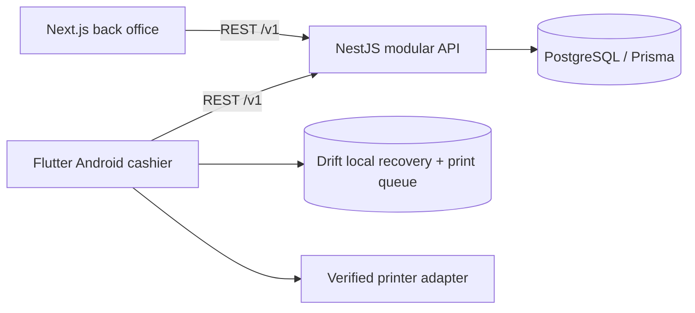
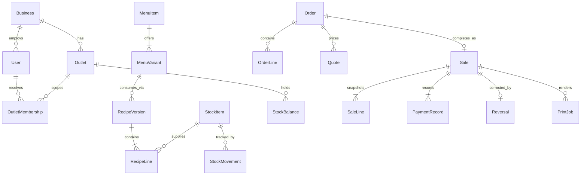
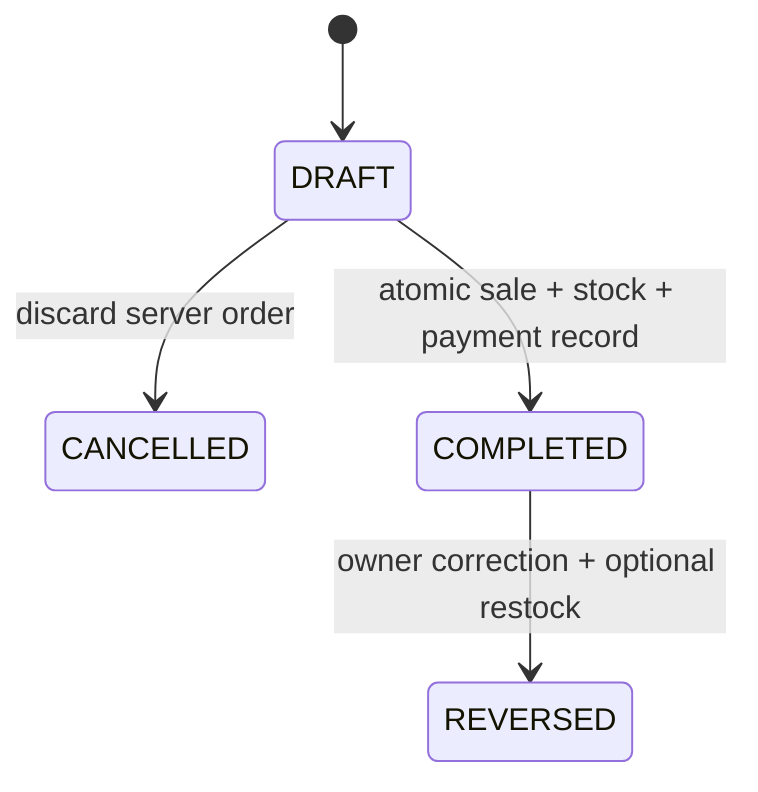

# Modern POS architecture — M01

Status: architecture baseline delivered for implementation. Date: 2026-11-07. UI direction awaits owner review under #2. This is a specification, not implemented infrastructure.

## 1. System and ownership

One API owns identity, authorization, prices, quotes, sale completion, inventory, and report calculations. Next.js must not access business tables directly. Flutter keeps presentation state, temporary carts, recovery references and local print jobs; it never independently decides the authoritative stock balance.

Use the selected stack in [TECH_STACK.md](TECH_STACK.md). One repository; `apps/web`, `apps/mobile`, `services/api`, `packages/api-client`, `packages/design-tokens`. Use pnpm workspaces only for TypeScript packages. Flutter uses pub and generated Dart models. Maintain OpenAPI as a contract baseline and validate generated NestJS documentation against it in #3; don't maintain two contradictory contracts.

Nest modules: Identity, Business, Catalog, Inventory, Orders, Sales, Reports, PrintMetadata. Controllers validate DTOs and apply authorization; application services orchestrate transactions; repositories encapsulate Prisma access. Inventory consumption is invoked inside the Sales transaction, not by a post-sale webhook.

Flutter: feature folders with View → Riverpod view-model/controller → repository → Dio service/platform adapter. Drift stores durable recovery/print state; platform secure storage stores refresh credentials. Share JSON design tokens and generated API models, not React components or TypeScript business logic.

## 2. Domain model

All IDs are UUIDs. All business-owned tables include business_id. Every outlet-owned table additionally includes outlet_id. Enforce composite foreign keys or equivalent database constraints so records cannot reference a different business/outlet. A URL outlet ID is never sufficient authorization.

| Entity | Required fields and invariants |
| --- | --- |
| Business | id, name, default currency, created_at |
| Outlet | id, business_id, name, IANA timezone, currency, receipt identity, settings_version; one operational outlet in MVP |
| User | id, business_id, normalized unique email, password_hash, active; roles are memberships, not client claims alone |
| OutletMembership | user_id, outlet_id, role OWNER/CASHIER, active; unique membership |
| Session | id, user_id, hashed refresh token, expires_at, revoked_at, device_id; rotate refresh token atomically |
| Device | id, outlet_id, name, active, last_seen_at; registered by owner |
| Category | id, business_id, name, sort_order, archived_at |
| MenuItem | id, category_id, name, description, archived_at; name snapshot copied to sale |
| MenuVariant | id, menu_item_id, name, price_minor, active, stock_policy TRACKED/UNTRACKED, revision; one Default variant for an item without choices |
| OutletMenu | outlet_id, variant_id, enabled; saleable only if item/variant/category/outlet configuration permits |
| StockItem | id, business_id, name, base_unit g/ml/each, quantity_scale 0..6, archived_at; base unit immutable after first movement |
| StockBalance | outlet_id, stock_item_id, quantity decimal(20,6), version; unique pair, quantity >= 0 in MVP |
| RecipeVersion | id, variant_id, outlet_id, version, effective_at, immutable after use; direct finished-goods link is a one-line recipe |
| RecipeLine | recipe_version_id, stock_item_id, quantity_per_sale_unit > 0; base-unit quantity, unique item per recipe |
| StockMovement | id, outlet_id, stock_item_id, delta, type OPENING/RECEIPT/ADJUSTMENT/SALE/REVERSAL, actor_id, reason, source_id, source_line_id, created_at; append only |
| Order | id, outlet_id, cashier_id, device_id, state DRAFT/COMPLETED/CANCELLED, version, created_at; one eventual sale maximum |
| OrderLine | id, order_id, variant_id, quantity positive integer; no fractional sell units in MVP |
| Quote | id, order_id, order_version, settings_version, expires_at, lines/totals/recipe revision references; immutable, 60-second validity |
| Sale | id, outlet_id, order_id unique, reference unique per outlet, state COMPLETED/REVERSED, currency, totals, cashier/device, completed_at |
| SaleLine | id, sale_id, item/variant names, unit price, quantity, tax/service calculation snapshot, recipe snapshot; immutable |
| PaymentRecord | id, sale_id, kind CASH/MANUAL_EXTERNAL, amount_minor, tendered_minor, change_minor, reference; RECORDED does not mean provider-verified |
| CheckoutRequest | outlet_id, device_id, idempotency_key unique together, request_hash, sale_id, retained_at; durable recovery mapping |
| Reversal | id, sale_id unique in MVP, actor_id, reason, totals snapshot, restock selections, created_at; no destructive edit of original sale |
| PrinterConfig | id, outlet_id, owning_device_id, name, transport, model, paper_width_mm 58/80, encoding, connection settings revision; no credentials in logs |
| PrintJob | id, sale_id, device_id, printer_config_id, copy flag, state, attempts, last_error; device owns execution |
| AuditEvent | actor, business/outlet, action, subject type/id, timestamp, request correlation ID, minimal change metadata |

Availability = minimum floor(balance / required quantity) across a recipe's ingredients. Aggregate shared ingredients across the whole cart before checking. TRACKED variants require a nonempty valid recipe; UNTRACKED is an explicit owner choice. Disabled catalog items are never saleable even with available stock. Treat stock availability on a screen as advisory; finalization is authoritative.

Unit conversion happens before persistence: kg→g ×1000; l→ml ×1000; each→each only. Accept fixed-point decimal strings, not JSON floating point, for all stock quantities. Reject precision loss, negative receipt quantities and incompatible units. A stock count delta may be negative only if the final balance stays nonnegative. Opening balance is a movement once per stock item/outlet, not an editable column.

## 3. Money, dates and pricing

- Money on the wire is a nonnegative JSON integer in currency minor units within JavaScript safe-integer range; database BIGINT, reject overflow. Currency code + configured exponent accompany money. IDR demo exponent is 0; never assume every currency has 2 decimals. No currency conversion or mixed-currency sales in MVP.
- Menu selling quantity is a positive integer. Stock quantities are decimal strings up to 6 places. Never calculate money or stock with binary floating-point intermediates in production.
- MVP prices are tax-exclusive. Service and tax basis points are owner-configured, default 0. Calculate `subtotal = sum(unit_price_minor * qty)`, `service = half_up(subtotal * service_bps / 10000)`, `tax = half_up((subtotal + service) * tax_bps / 10000)`, `total = subtotal + service + tax`. Tax-on-service is this MVP rule, not a claim about local tax law. Owner must validate their required rules before production. Inclusive pricing is deferred until explicitly specified.
- Cash tender must be >= total, change = tender-total. For manual external payment, amount must equal total, tender/change are omitted. One payment per sale in MVP. Do not log full payment credentials.
- Store timestamps in UTC. Each outlet has an IANA timezone. Reports use half-open intervals `[local start-of-day, local day after end-date)` converted to UTC. Label dates and timezone. Timezone changes apply to future operational periods and are audited; preserve the completed sale's timezone snapshot.
- Prices, recipe versions and settings used for a sale remain on the sale even after catalog updates. A stale quote returns QUOTE_EXPIRED or QUOTE_STALE and requires cashier review of the new amount; never silently increase tender or charge a changed total.

## 4. Sale state and transaction boundary

`COMPLETING`, `UNKNOWN`, `RECOVERING` are client UI states, not proof of sale outcome. Client must persist device_id, order_id, quote_id, idempotency_key, and submitted payload before network submission. Order draft persistence is online; unsent local cart is not a paid sale.

Finalization protocol, implemented under #9/#10/#12:

1. Authorize current business/outlet membership and device. Validate request and canonical payload hash. Check an existing idempotency mapping before checking quote expiry: an already-completed retry must return the original sale even after its quote expires.
2. Run a PostgreSQL SERIALIZABLE transaction. Lock/guard order and all affected stock balance rows in sorted stock-item-ID order. Read current settings, variants and recipe versions. Recheck order is DRAFT, quote/order versions, expiry, active catalog and stock.
3. Aggregate ingredient consumption for all lines using recipe snapshots. Reject insufficient stock with item-specific shortages. Insert immutable Sale, SaleLines, PaymentRecord; append SALE movements; decrement balances with nonnegative guards; mark Order COMPLETED; insert CheckoutRequest mapping. All commit together or none commit.
4. Use unique `(outlet_id,device_id,idempotency_key)`, unique Sale.order_id, and unique movement source identifiers as independent protections. Same key/different canonical payload is 409 IDEMPOTENCY_CONFLICT. A different key for an already-completed order is 409 ORDER_ALREADY_COMPLETED with recoverable sale ID for an authorized caller.
5. Retry serialization/deadlock failures with bounded jitter (maximum 3 attempts). If still unavailable return retryable 503, preserving client key. Do not call printers, external services or payment providers inside a DB transaction.
6. After commit return the sale. Client queues the receipt by stable sale reference. If response is lost, recovery GET resolves the original key; do not invent another key because a request timed out. A not-found response is not sufficient if an original request is still in flight: wait/poll or resubmit the same key/payload, which is safe under unique constraints.

Retain checkout mapping for the lifetime of the sale in MVP. API returns the same semantic sale on replay (replayed flag may differ). Print completion never determines sale completion.

## 5. Reversals and reports

Owner-only full reversal: reason required, one reversal per sale, its own idempotency key. Append financial reversal record; leave original sale and consumption untouched. Restore only explicitly selected stock items/quantities that are physically returned and restockable. An ingredient used in prepared food is normally not restockable. Enforce restored qty <= original consumed qty and no duplicate reversal movements. Audit actor and restock choices. Mark Sale REVERSED atomically with the reversal and stock updates.

Manual external reversal means a correction record only. It must never say a provider refunded money. Receipt labels this distinction. Partial refunds/provider refunds are Phase 2.

Report definitions: gross item sales = completed item subtotals in the period; reversal item value = item subtotal of reversals created in the period; net item sales = gross - reversal item value; charges and payments are separate. Sale count counts completions; reversal count counts reversals; average bill = gross item sales / sale count (zero if none). A reversal today of yesterday's sale appears today, linked to the original. Reports include currency, timezone, filters, calculation labels and generation timestamp. Inventory movement references reconcile sale and reversal quantities. No profit claims until a costing policy exists.

## 6. API baseline

[API.openapi.json](API.openapi.json) is OpenAPI 3.0.3, contract version 0.1.0. Server prefix `/v1`; scoped operations include `/outlets/{outletId}`. UUID path IDs, RFC3339 UTC timestamps, cursor pagination (default 25, max 100), list search max 100 chars. Optimistic mutation revision is required for catalog/recipe/settings updates; return 409 VERSION_CONFLICT rather than overwriting concurrent edits.

Main groups: auth/session; outlet config/devices; categories/menu variants; stock/receipts/adjustments; recipes; orders/quotes/finalization/recovery; reversal; sale history/report/CSV; printer config/job metadata. Owner-only write operations are marked with `x-roles`; these are requirements for backend guards, not automatic OpenAPI enforcement.

Errors use `{code,message,requestId,details?,retryable}`; messages are human-readable, codes are stable. 400 malformed input, 401 session absent/expired, 403 insufficient role, 404 absent or out-of-scope record, 409 stale versions/stock/idempotency conflict, 422 semantic validation, 429 rate limit, 503 transient failure. Never leak another business's record through error details. CSV exports mitigate spreadsheet formula injection in text fields. Logs redact credentials and customer data.

For non-checkout idempotent writes (receipts, adjustments, order creation, reversal and print metadata), scope keys by business/outlet + operation + device when supplied, persist the canonical request hash and committed result, and reject a changed payload with 409. Bind the original actor/session authorization on recovery. No idempotent endpoint may perform its side effect before its key/result record can commit atomically with that effect.

## 7. Identity/security baseline

Use Nest Passport JWT strategies, Argon2id password hashes and opaque random refresh tokens stored hashed server-side. Short-lived access tokens (10 minutes), rotating refresh sessions (7-day absolute lifetime), immediate session revocation checked on protected operations. Implement rotation reuse detection and revoke the affected session family. Owner provisioning is a documented deployment/admin action in MVP; no public self-signup or role escalation endpoint.

Web: same-origin Next proxy to API; refresh cookie HttpOnly, Secure, SameSite=Lax with explicit CSRF protection on cookie-authenticated state changes. Flutter: bearer access token in memory, refresh token in platform secure storage. Never expose browser refresh tokens to JavaScript. The contract distinguishes web cookie and mobile refresh exchange. Login rate limiting and audit are required. TLS outside local development, narrowly configured CORS, validated request sizes, database least privilege and encrypted backups.

Owner: catalog/stock/settings/users/reversal/reports. Cashier: authorized outlet catalog, own draft orders/quotes/finalization/recovery, own/current authorized sale receipt and print operations. Backend filters sale lists for cashiers; report export is owner-only. Printer hardware tests must not grant cashiers management permissions accidentally.

## 8. Printing and connection risk

Only the device that owns a print job executes it. The Drift queue is written before any bytes are sent. Local states: QUEUED → SENDING → SENT, or FAILED (known not sent) / UNKNOWN (delivery ambiguous). App restart while SENDING becomes UNKNOWN. FAILED jobs may be retried automatically with a bounded backoff (5s, 15s, 60s; at most 3 automatic and 5 total attempts). Do not automatically resend ambiguous jobs; the manual recovery action is a deliberate COPY reprint. Stable job IDs prevent duplicate queue insertion; a sale has one original job and reprints are separate COPY jobs. PrintJob metadata sent to API is diagnostic; the local queue works independently of a post-sale metadata failure. See `docs/receipt-printing.md`.

Define `PrinterAdapter.connect`, `testPrint`, `printReceipt`, `disconnect`; adapters return classified error/delivery status. One named real model/transport, one paper width and one verified encoding are the MVP release gate under #15. Prototype printer states are simulation only. Device pairing, Android permissions, Bluetooth reconnection, LAN reachability, USB host capability, Indonesian text and 58/80mm wrapping need physical testing. Never promise support for all models or physical exactly-once printing.

## 9. MVP boundaries and growth

MVP: connected Android cashier; owner web; one business/outlet; menu variants; direct/ingredient recipes; receiving and adjustments; atomic sale and reversal; cash/manual external record; daily reports/CSV; one validated receipt printer. No full offline sale acceptance, integrated charging, table splitting, promotions, purchasing or multi-outlet UI yet.

Phase 2 adds offline outbox/inbox with immutable client transaction IDs and an explicit stock allocation/oversell policy. Do not accept offline paid sales until that policy is approved and tested. Introduce tables/open orders/reservations without changing historical sale semantics. Add provider webhook reconciliation as a separate lifecycle. Preserve outlet IDs, recipe history and currency snapshots now so future features don't require rewriting historical facts.

## 10. Deployment and checks

Local Docker Compose: PostgreSQL + optional API/web. CI: format/types, Flutter analyze/tests/build, API PostgreSQL integration tests, web smoke tests, OpenAPI lint/client generation. Stage API/web as containers behind TLS with managed PostgreSQL; configure secure environment secrets, health/readiness checks, structured correlation logs and daily encrypted backup. Rehearse restore before production. Provider and exact stable version pins are implementation decisions under #3/#18, not reasons to change the selected stack.

Required integration scenarios: two devices sell last unit; shared ingredients across cart; repeat key with same/different payload; lost checkout response; transaction rollback; expired/stale quote; catalog archive during checkout; fractional recipe quantity; wrong outlet access; reversal/restock limits; printer failure after committed sale; report date boundary/reversal across days; token refresh reuse. These are implementation tests, not claimed completed by this design deliverable.

## 11. Delivery order and outstanding validation

Start #3 scaffolding from this document while #2 awaits style review. Then #4 auth, #6 catalog and #7 ledger; #8 recipes + #9 pricing; #10 transactional finalization; #11/#12 Flutter wiring; #13/#14 web stock/reports; #15/#16 printer adapter/queue; #17 reversal; #18 release verification. User review of #2 gates visual implementation, not backend scaffolding.

Hardware model/transport and business tax/receipt requirements must be supplied before production verification. Hosting region/budget and exact dependency pins are open under #3/#18. No production customer data or credentials have been used in these design artifacts.

References: [Flutter architecture](https://docs.flutter.dev/app-architecture/guide), [Nest OpenAPI](https://docs.nestjs.com/openapi/introduction), [PostgreSQL transaction isolation](https://www.postgresql.org/docs/current/transaction-iso.html).
