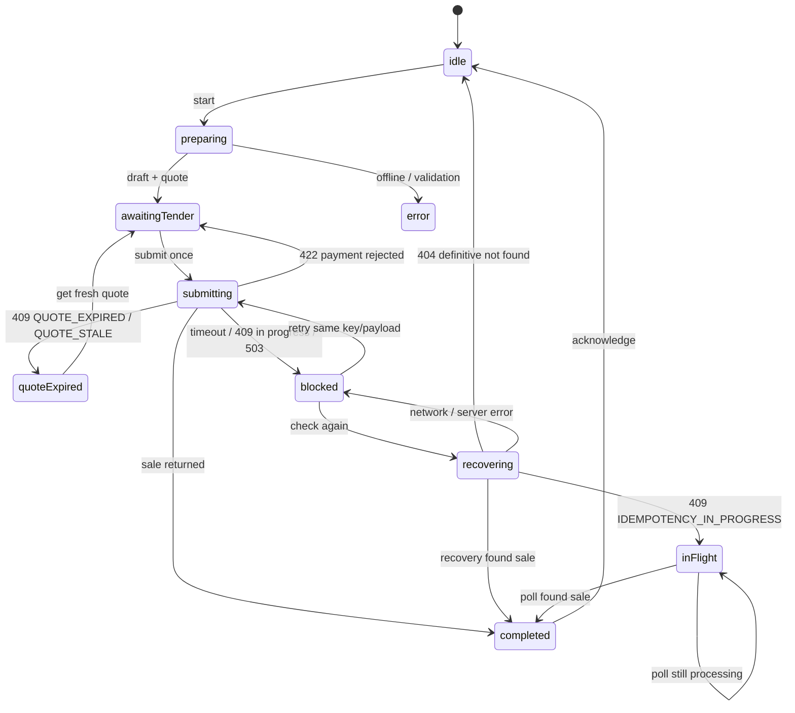

# Checkout and uncertain-outcome recovery (#12)

Android cashier checkout normally creates a server draft order, requests an
immutable 60-second quote, records the tender, and sends one finalize request.
When the API is unreachable the cashier can record an offline capture in the
encrypted queue (#19). A print failure never repeats the sale.

## Ownership boundary

- `apps/mobile` owns checkout, tender entry, completion and receipt rendering.
- `apps/api` owns prices, quote validity, totals, payment validation, stock
  consumption and the durable checkout mapping.
- `apps/web` has no checkout, tender or sale-initiation route or action. The
  back office can only read sales and reports produced by the API.

## Implemented flow

1. **Draft order.** `POST /outlets/{id}/orders` with `{deviceId, lines}` and a
   UUID `Idempotency-Key`. The device id comes from secure storage and survives
   restarts.
2. **Quote.** `POST /outlets/{id}/orders/{orderId}/quotes` with the draft order
   version. The quote is immutable, lasts 60 seconds, and is the source of the
   amount due.
3. **Tender.** Cash requires `tenderedMinor >= total`; the client shows live
   change and blocks submission below the total. Manual external payment
   requires the entered amount to equal the total and omits tender/change.
4. **Persist before network.** The client writes the finalize key, device id,
   order id, quote id, exact payment payload and totals to Drift
   (`checkout_intents`) before the finalize request leaves the device. The
   payload is AES-256-GCM encrypted; see `docs/offline-sync.md`.
5. **Finalize.** `POST /outlets/{id}/sales/finalize` with the same key and
   payload. The button is disabled in flight and the controller ignores
   duplicate calls, so repeated taps produce one HTTP request.
6. **Completion.** The server returns the sale. The client shows the sale
   reference and receipt, marks the intent confirmed, clears the cart and makes
   a best-effort print attempt. Printing is not part of the transaction.

## Client state machine



`preparing`, `submitting`, `recovering`, `inFlight`, `blocked` and
`quoteExpired` are client states. Only a server sale proves completion.

## Recovery protocol

A pending intent blocks every new sale. On restart, timeout or an unknown
response the client performs `GET /outlets/{id}/checkout-requests/{key}?deviceId=`
with the retained key **before** permitting a retry or a new attempt.

| Server answer | Client behavior |
| --- | --- |
| `200` with sale | Mark confirmed, clear the cart, show the reference and receipt. No new finalize is sent. |
| `404 NOT_FOUND` | Recheck with the same key before accepting it as definitive. A single 404 can race an in-flight commit, so the client requires three consecutive 404 answers (2 seconds apart), then marks failed and allows a fresh attempt with a **new** key. |
| `409 IDEMPOTENCY_IN_PROGRESS` | Keep the pending key, block new sales and poll. Never re-submit. |
| Repeated `404` | Only after the confirmation window is exhausted may a new attempt use a new key. |
| Network / timeout | Keep the pending key, block new sales, offer Check again and retry with the same key. |
| `409` other / `503` | Keep the key and block; a retryable finalize reuses the same key and payload. |

`QUOTE_EXPIRED` and `QUOTE_STALE` are not recovered as a sale. The client
clears the uncommitted key, shows the server message and requires an explicit
fresh quote so the cashier reviews any new total. Nothing is re-priced or
re-submitted silently.

`ORDER_ALREADY_COMPLETED` clears the local cart because the order is already
paid; the reference is available from sales history (#14).

## Proofs

- `test/checkout_controller_test.dart` covers tender/change, single submit,
  persist-before-request, quote expiry, pending-key blocking, restart recovery,
  definitive not-found with a new key, in-flight polling, 503 retry with the
  same key, offline blocking and print-failure non-repetition.
- `test/checkout_screen_test.dart` covers the cashier tender/keypad/change,
  duplicate taps, disabled short tender, offline message, recovered receipt,
  fresh-quote requirement and the print warning.
- `test/checkout_live_api_test.dart` (guarded by `CHECKOUT_API_BASE_URL`) proves
  one sale, replay, recovery and one `SALE` stock movement per consumed
  ingredient against the real API. Re-run with:

  ```bash
  CHECKOUT_API_BASE_URL=http://localhost:4000 \
    flutter test test/checkout_live_api_test.dart
  ```

## Deferred and limitations

- #16 owns the print queue, automatic retries and reprints. #12 only renders and
  attempts one best-effort print after the sale exists.
- #17 owns reversals. #12 has no reversal UI.
- #19 implements offline capture and sync in `docs/offline-sync.md`. Stock is
  not reserved while offline; the server may reject a synced sale with
  `INSUFFICIENT_STOCK`, which becomes a cashier-visible conflict. A cold offline
  capture uses the local cart total and becomes a conflict if the server total
  changed.
- Sale history, reporting and CSV remain #14.
- Hardware print output is `PENDING — requires Android device and printer`.
  A successful transport write is not proof of physical output.
- The recovery mapping is retained for the lifetime of the sale in the MVP.
  Old confirmed/failed rows are kept locally for audit and ignored by
  `loadPending`.
