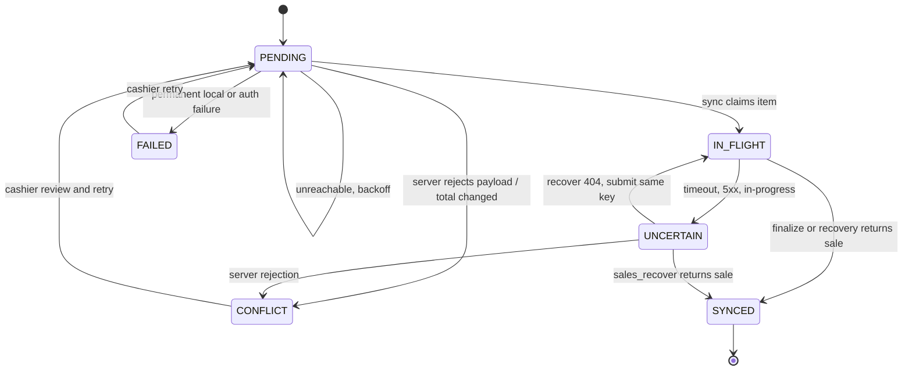

# Offline sales and reliable synchronization (#19)

This document describes the client-side offline sale queue, its encryption, the
synchronization state machine, the stock policy and the evidence used to verify
reconnect and concurrent edits. The API contract is unchanged: there is no
server-side sync endpoint. Offline behaviour is built from the existing
idempotent operations:

| Operation | Purpose |
| --- | --- |
| `POST /outlets/{outletId}/sales/finalize` | Submit the sale with the retained `Idempotency-Key`. |
| `GET /outlets/{outletId}/checkout-requests/{key}?deviceId=` | Resolve an uncertain outcome with `sales_recover`. |
| `GET /outlets/{outletId}/sales?from&to&cursor` | Reconcile the server sales ledger. |
| `GET /outlets/{outletId}/stock` | Owner-only stock reconciliation used by the verification transcript. |

No new sync API, operation or schema was added to `API.openapi.json`.

## Storage and encryption

The encrypted queue lives in the existing Drift `checkout_intents` table. The
payload is the complete offline sale request: idempotency key, order key,
outlet, device, draft order and quote ids (when known), line snapshots, tender,
totals, currency and timestamps.

- **Cipher:** AES-256-GCM (Dart `cryptography` package, `AesGcm.with256bits()`).
- **Key:** 32 random bytes generated with `Random.secure()`, stored only in
  `flutter_secure_storage` under `pos_offline_queue_key_v1` (Android Keystore
  backed).
- **Envelope:** fresh 12-byte nonce per write, base64 ciphertext, nonce, MAC and
  a SHA-256 digest of the clear payload. Key version `v1` is stored with the
  envelope.
- **Plaintext columns:** the queue row keeps only the idempotency key, sync
  state, attempt counter and timestamps for indexing. The legacy metadata
  columns are written blank for encrypted rows.
- **No fallback:** a missing key throws `OfflineKeyMissingException`; tampered
  ciphertext, MAC, digest or key version throws `OfflineDecryptionException`.
  The app never decodes a plaintext queue row as a fallback and never logs the
  key or plaintext payload.
- Legacy rows written before schema version 5 have no ciphertext. They are read
  once from their old columns and are not rewritten; new writes are always
  encrypted. Re-keying or losing secure storage makes encrypted rows
  unreadable by design, and the UI reports the failure instead of guessing.

Tests:

- `test/offline_crypto_test.dart` proves round-trip, tamper failure, missing-key
  failure, wrong-key authentication failure and absence of the key/plaintext in
  the envelope.
- `test/offline_sale_repository_test.dart` writes a sale, closes the database,
  reopens the same file, decrypts it, reads raw SQLite rows and proves no
  plaintext marker or key appears in storage.

## Queue states



- `PENDING`: durable and safe to retry.
- `IN_FLIGHT`: claimed by the single sync loop.
- `SYNCED`: a server sale exists for the key; never submitted again.
- `UNCERTAIN`: a request may have reached the server (timeout, 5xx,
  `IDEMPOTENCY_IN_PROGRESS`, or a crash while a row was `IN_FLIGHT`). It is
  resolved with `sales_recover` before any resubmission. On restart, an
  `IN_FLIGHT` row is first moved to `UNCERTAIN`; it is never skipped forever.
- `CONFLICT`: the server rejected a sale the device recorded. The server reason
  is shown to the cashier; no automatic retry or new key is created.
- `FAILED`: permanent failure (corrupt storage, missing key, authentication
  failure, exhausted attempts). The row is retained for audit.

The cashier screen `Settings > Offline sales & sync` shows per-item state,
counters, last error, retry and discard actions. A badge in the shell and the
checkout app bar shows the number of active items.

## Idempotency and single-flight

- Every sale has one checkout key and one order key. Both survive restarts in
  the encrypted payload.
- A cold offline sale creates its draft order with the retained `orderKey`; a
  retry cannot create a second order. The quote and finalize reuse the same
  checkout key.
- `OfflineSyncController` has an in-process single-flight guard. Repeated taps,
  multiple screens and concurrent triggers share one replay loop and submit each
  item once. Tests hold a finalize `Completer`, call `syncAll()` twice, and
  observe exactly one request.
- Already `SYNCED` rows are skipped by `syncAll()` and by `retry()`.
- `sales_recover` is used for `UNCERTAIN` rows before a finalize is attempted.
- Retry uses bounded exponential backoff: 2 s, 4 s, 8 s ... capped at 5 minutes.
  A failed sync never deletes the encrypted payload.

The API proves the same key returns the same sale (`replayed: true`) and creates
one `SALE` stock movement per ingredient. That behaviour existed before #19 and
is re-exercised by the live reconnect transcript below.

## Stock policy

**Stock is not reserved while a device is offline.** The server remains the only
authority for stock. At finalize the server locks the affected balances, checks
`available >= required`, writes one `SALE` movement, and rejects the request with
`422 INSUFFICIENT_STOCK` rather than allowing a negative balance. Stock is not
allocated per device and offline devices may oversell their local belief.

This choice is deliberate:

- Reservation would require either a new server API or long-lived holds that
  the current contract does not support.
- The server transaction is already atomic and serializable, so the first
  accepted sale wins and every later attempt gets a clean rejection.
- A rejected offline sale becomes `CONFLICT` with the server's shortfall
  details, not a silent success and not a second sale.

The cashier is told before recording an offline sale that stock is not reserved
and that the server may reject it. The conflict screen explains the cashier
action: compare the paper receipt, refund or collect the difference, and retry
only after the server state allows the recorded total.

## Cold offline capture

When the API is unreachable, `Checkout > Record offline sale` stores the cart,
line snapshots and a cash tender equal to the local cart subtotal in the
encrypted queue, clears the cart, and shows the pending key. During sync the
server creates the draft order and quote from the recorded lines and compares
the server total (including tax, service and rounding) with the local total.

- Equal total: the sale is finalized with the recorded key and becomes
  `SYNCED`.
- Different total: the row becomes `CONFLICT` with both amounts; no finalize is
  sent and no payment is silently re-priced.
- Insufficient tender after a server total change: `CONFLICT` with the
  shortfall.
- Insufficient stock: `CONFLICT` with the server shortage details.

This means a cold offline sale is an **offline capture**, not a guarantee of
server acceptance. The limitation is explicit in the UI and below.

## Reconciliation

After a sync the screen can fetch the server sales ledger and compare it with
the local `SYNCED` records:

- Local synced count, server-matched count, server sales scanned, and the list
  of missing checkout keys.
- A mismatch is shown in red with the missing keys; local evidence is kept.
- Sales reconciliation is available to the cashier role because `GET /sales`
  permits `OWNER` and `CASHIER`.
- Stock balances and daily reports are owner-scoped. They are included in the
  owner verification transcript below rather than exposed to the cashier app.

## Reconnect and concurrent-edit verification

Environment: local PostgreSQL/API stack, seed data, two synthetic devices racing
the same low-stock item. Both devices record the sale while the API is
unreachable, then sync. The transcript records real HTTP status codes, movement
counts and final balances.

Observed transcript (local API, 2026-11-11):

```text
before: cups=0 version=13 reportSaleCount=21
low stock: cups=1 version=14
offline drafts: A order=1520ac1c-ac1c-4162-98a0-e461d988818a quoteTotal=35000; B order=88cc57bf-75a3-45cd-95ae-1d1998c02f21 quoteTotal=35000
finalize A: status=200 sale=e55942e3-f694-43a1-bebf-a4cd4f2cfb66 reference=SALE-1520ac1c-ac1c-4162-98a0-e461d988818a replayed=false
finalize B: status=422 code=INSUFFICIENT_STOCK message=Insufficient stock for this sale
winner replay: status=200 sale=e55942e3-f694-43a1-bebf-a4cd4f2cfb66 replayed=true
after balances: cups=0 coffee=8150 milk=9000
movements Paper Cups: saleMovements=1 delta=-1
movements Coffee Beans: saleMovements=1 delta=-150
movements Fresh Milk: saleMovements=1 delta=-200
sales ledger: matchingSaleCount=1
report: baselineSaleCount=21 afterSaleCount=22 delta=1
TRANSCRIPT OK: one accepted sale, one 422 conflict, one movement per ingredient, no negative stock
```

Interpretation:

- Both devices held a valid draft and quote for one Chicken Rice while the
  last paper cup was available. No stock was reserved by either draft.
- The concurrent finalizes raced on the server transaction. Device A received
  `200` with a completed sale; device B received `422 INSUFFICIENT_STOCK` with
  the shortage reason. There was no negative balance and no second sale.
- Replaying device A's key returned `200 replayed=true` with the same sale id.
- Each consumed ingredient had exactly one `SALE` movement for the accepted
  sale. The paper cup balance ended at `0`, not negative.
- The owner sales ledger contained exactly one matching sale, and the daily
  report increased by exactly one sale.


Commands used:

```bash
docker compose up -d
docker compose exec -T api pnpm prisma migrate deploy
docker compose exec -T api pnpm prisma db seed
# See the transcript harness in the ticket verification notes.
```

## Limits

- There is no server sync endpoint and no server-side queue. A device must keep
  its encrypted queue; clearing app data or losing the secure-storage key makes
  the queue unreadable (loud failure, no plaintext fallback).
- Cold offline capture cannot know the server's tax, service, rounding or price
  changes. A changed total becomes a conflict.
- Stock is not reserved. Two devices can attempt the same last unit; the server
  accepts one and rejects the other with no negative balance and no double sale.
- The cashier app can reconcile sales. Stock and report reconciliation requires
  an owner session and is documented here rather than exposed to cashiers.
- Real multi-device field testing is not possible on this VPS. The logic is
  simulated in unit tests and exercised against the real API with two device
  ids and keys.
- A corrupt queue blocks the affected item and reports an actionable error; it
  is never silently discarded.

## Tests

| Test | Coverage |
| --- | --- |
| `offline_crypto_test.dart` | AES-GCM round trip, tamper, missing/wrong key, no key in envelope. |
| `offline_sale_repository_test.dart` | Restart persistence, raw SQLite plaintext/key scan, corrupt ciphertext, missing key. |
| `offline_sync_controller_test.dart` | Cold replay with same keys, replay-no-duplicate, single-flight, uncertain recovery, stock conflict, total conflict, offline backoff, two-device race, reconciliation. |
| `checkout_controller_test.dart` | Airplane-mode capture stays pending, cart cleared, no finalize. |
| `offline_sync_screen_test.dart` | Empty, pending, sync and conflict UI states with cashier actions. |
